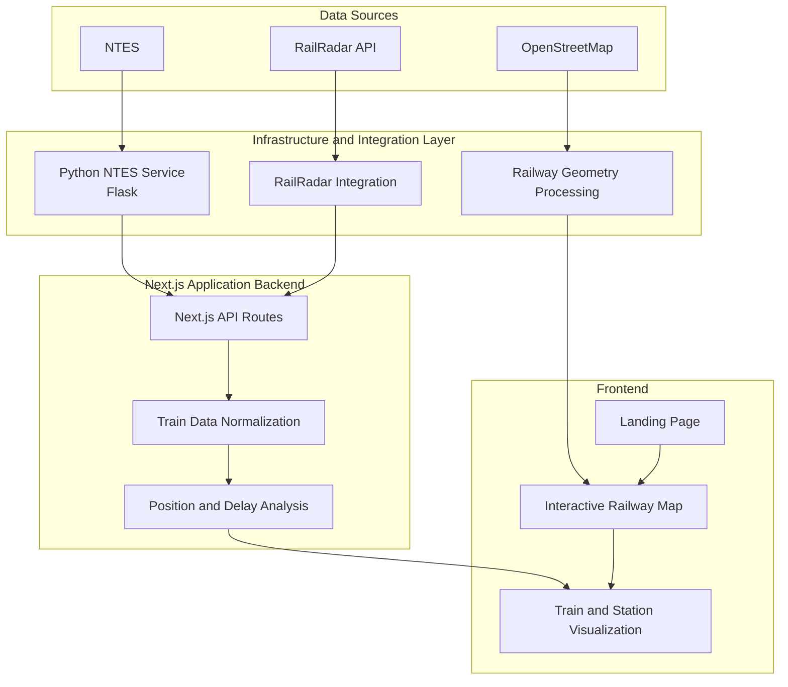

# RailPulse — Indian Railway Network Intelligence

**See India's railway network in motion.**

RailPulse is a railway network visualization and intelligence platform designed to combine railway infrastructure data with available train-running information in a unified, interactive application.

The project integrates railway geometry from OpenStreetMap with NTES and RailRadar data sources. Its goal is to make railway infrastructure easier to explore and establish a foundation for train tracking, track-aware position estimation, delay analysis, and network-level intelligence.

RailPulse is currently an evolving prototype, with infrastructure visualization and initial train-data integrations forming its core.

---

## Table of Contents

- [Overview](#overview)
- [System Architecture](#system-architecture)
- [How the System Works](#how-the-system-works)
- [Technology Stack](#technology-stack)
- [Current Capabilities](#current-capabilities)
- [Project Structure](#project-structure)
- [Getting Started](#getting-started)
- [API Endpoints](#api-endpoints)
- [Data Sources and Positioning](#data-sources-and-positioning)
- [Limitations](#limitations)
- [Roadmap](#roadmap)
- [Contributing](#contributing)
- [License](#license)

---

## Overview

Traditional railway maps focus primarily on infrastructure, while train-running services focus on individual train status. RailPulse explores how these two perspectives can be brought together.

The application consists of three primary parts:

1. **Railway infrastructure layer** — railway tracks and station geometry used to visualize the network.
2. **Train information layer** — integrations that retrieve available train-running information.
3. **Interactive application layer** — a web interface for exploring railway infrastructure and visualizing supported train information.

The long-term objective is to evolve from infrastructure visualization and individual train lookups into a broader railway intelligence platform.

## System Architecture

RailPulse follows a modular architecture in which the frontend, backend API routes, railway data, and external train-information integrations have distinct responsibilities.

### High-level architecture



*The diagram represents the intended integration flow and architectural responsibilities. Individual processing steps depend on the current implementation and the availability of the underlying data.*

### Architecture components

**1. Railway infrastructure data**

OpenStreetMap provides the underlying railway geometry and station-related spatial information. The data can be processed into GeoJSON and consumed by the map interface.

**2. NTES integration service**

A Python service built with Flask provides a local integration layer for retrieving train-running information from the NTES client library. It runs separately from the Next.js application.

**3. RailRadar integration**

The RailRadar integration supports detailed train lookups through the application's backend API routes.

**4. Next.js API layer**

The Next.js backend exposes application endpoints for train and station information. This layer connects the frontend to the relevant integrations and supports the application's data-processing logic.

**5. Analysis and position processing**

Available train information can be normalized and used for delay analysis and position estimation. The reliability of these outputs depends on the fields provided by the underlying sources.

**6. Frontend application**

The frontend contains the landing page and interactive railway map. The landing page introduces the project, while the map provides the primary interface for exploring infrastructure and supported train information.

---

## How the System Works

### 1. Railway infrastructure preparation

Railway-track and station geometry is sourced from OpenStreetMap. Relevant spatial data is processed into formats such as GeoJSON for use by the mapping layer.

### 2. Map rendering

The frontend uses MapLibre to render the map and railway-related layers. Users can navigate the map and explore available railway infrastructure.

### 3. Train information retrieval

When train information is requested, the relevant Next.js API route communicates with the appropriate integration:

- NTES requests use the local Python service.
- RailRadar requests use the RailRadar integration.

### 4. Data processing

The backend processes or normalizes the available train information for consumption by the frontend. Where supported, running-status information can contribute to delay analysis or train-position estimation.

### 5. Visualization

The application presents available infrastructure and train information through its map interface.

**Important:** This workflow does not imply continuous GPS tracking of locomotives or complete coverage of all trains in India. Those capabilities require additional data coverage and development.

---

## Technology Stack

| Technology | Role |
|---|---|
| Next.js | Web application framework, routing, and backend API routes |
| React | Frontend components and user interface |
| TypeScript | Type-safe application development |
| CSS Modules | Component-scoped styling |
| MapLibre | Interactive map rendering |
| OpenStreetMap | Railway infrastructure data |
| OpenRailwayMap | Railway-oriented map visualization |
| GeoJSON | Spatial data representation |
| Python | NTES integration service |
| Flask | Local HTTP service for NTES integration |
| NTES | Train-running information source |
| RailRadar | Detailed train lookup integration |

---

## Current Capabilities

- Interactive railway infrastructure visualization.
- Railway geometry sourced from OpenStreetMap.
- Map-based exploration of available station and railway data.
- NTES train-running information integration.
- RailRadar-based detailed train lookup.
- API routes for train and station information.
- Initial train visualization using available running-status data.
- Position classification that distinguishes actual, calculated, and unknown positions where supported.
- Responsive landing page introducing the project and its development roadmap.

The scope and reliability of each feature depend on the current implementation, source availability, and configuration.

---

## Project Structure

The repository is organized around the Next.js application, the NTES service, and railway-data processing utilities.

```text
RailPulse/
├── app/
│   ├── page.tsx
│   ├── landing/
│   │   ├── LandingPage.tsx
│   │   ├── LandingInteractions.tsx
│   │   └── landing.module.css
│   ├── map/
│   └── api/
│       ├── trains/
│       └── stations/
├── lib/
│   └── live-trains/
├── ntes-service/
├── public/
│   └── data/
├── scripts/
├── .env.example
├── package.json
└── README.md
```

*This is a conceptual overview of the main areas, not an exhaustive listing of every repository file. Exact filenames and configuration files may vary with the current version.*

---

## Getting Started

### Prerequisites

- Node.js compatible with the project's Next.js version.
- npm.
- Python for the NTES service.
- Git.

### 1. Clone the repository

```bash
git clone https://github.com/Sipivishta/RailPulse.git
cd RailPulse
```

### 2. Install Node.js dependencies

```bash
npm install
```

### 3. Configure environment variables

Create a `.env.local` file in the project root and configure the variables required by the application's existing API routes and integrations.

For example, if the service URL is configurable:

```env
NTES_SERVICE_URL=http://127.0.0.1:5001
```

This variable is an example; use the exact environment-variable names expected by the current code.

Do not commit `.env.local`, API keys, credentials, or private tokens.

### 4. Set up the NTES service

Open a separate terminal:

```powershell
cd ntes-service
python -m venv .venv
.\.venv\Scripts\Activate.ps1
```

Install the dependencies specified by the service's dependency file, if present. For example:

```bash
pip install -r requirements.txt
```

Start the Flask service using the entry point and command configured in the repository. The expected local service address is typically `http://127.0.0.1:5001`.

### 5. Start the web application

Return to the project root and run:

```bash
npm run dev
```

Open the application:

- Landing page: `http://localhost:3000`
- Railway map: `http://localhost:3000/map`

Train-information features may require the NTES service to be running, appropriate environment variables, and access to external data sources.

### 6. Production build

```bash
npm run build
```

Start the production server after the build completes successfully:

```bash
npm run start
```

---

## API Endpoints

The application includes the following train and station API routes.

| Endpoint | Purpose |
|---|---|
| `/api/trains/live` | Detailed train lookup through RailRadar |
| `/api/trains/ntes` | Train-running information through the NTES integration |
| `/api/trains/ntes-live` | NTES live-status integration |
| `/api/stations/[code]/live` | Station-specific live information |

These routes depend on the current backend implementation and the availability of the associated integrations.

---

## Data Sources and Positioning

### OpenStreetMap

OpenStreetMap supplies railway infrastructure geometry used by the mapping layer. Spatial data may be processed and stored locally in GeoJSON format.

OpenStreetMap data is available under the Open Database License, subject to its attribution requirements.

Reference: https://www.openstreetmap.org/copyright

### NTES

NTES is used as a source of available train-running information through the local Python integration service.

### RailRadar

RailRadar supports detailed train lookups through the application's API layer.

### Position interpretation

RailPulse distinguishes between different levels of position information where the implementation supports them:

- **Actual:** A position explicitly represented as actual by the relevant data source or application logic.
- **Calculated:** An estimated position derived from available running information.
- **Unknown:** A position that cannot be reliably determined from the available information.

A calculated position must not be interpreted as a verified GPS location. Track-aware position estimation and wider train coverage remain areas for further development.

---

## Limitations

RailPulse is a developing prototype. The following limitations should be considered:

- Nationwide tracking of every running train is not guaranteed.
- Position accuracy depends on the information provided by the underlying data sources.
- Infrastructure geometry may be incomplete or outdated in some areas.
- External integrations may be affected by availability, access restrictions, or rate limits.
- Some train and station capabilities may require additional configuration or implementation.

RailPulse is intended for exploration and development, not as an authoritative source for operational railway decisions or travel-critical information.

For official travel information, refer to the relevant Indian Railways services.

---

## Roadmap

### Infrastructure and integration
- Improve station search and station information reliability.
- Improve railway geometry coverage and data-processing workflows.
- Strengthen error handling and integration reliability.

### Train tracking
- Expand train discovery beyond the initial test cases.
- Develop track-aware train-position estimation.
- Improve the representation of train movement along railway corridors.

### Railway intelligence
- Develop richer delay analysis.
- Explore corridor-level activity and traffic patterns.
- Introduce historical train-movement replay.

### Engineering improvements
- Expand automated testing.
- Improve configuration and deployment documentation.
- Strengthen data validation and observability.

These are development goals; they should not be interpreted as completed features.

---

## Contributing

Contributions, bug reports, and suggestions are welcome.

1. Fork the repository.
2. Create a feature branch.
3. Implement your changes.
4. Test the relevant functionality.
5. Submit a pull request describing the changes.

For larger architectural changes, consider opening an issue before beginning implementation.

---

## Security

- Keep secrets in environment variables.
- Never commit `.env.local` or private credentials.
- Avoid exposing server-side API credentials in client-side code.
- Validate data received from external integrations.

---

## License

No license is specified in this README. Add a `LICENSE` file to establish the terms under which others may use, modify, or distribute the project.

---

## Project

**RailPulse — Indian Railway Network Intelligence**

Repository: https://github.com/Sipivishta/RailPulse

*An evolving project exploring how railway infrastructure and train-running information can be brought together to create a more connected view of India's railway network.*
